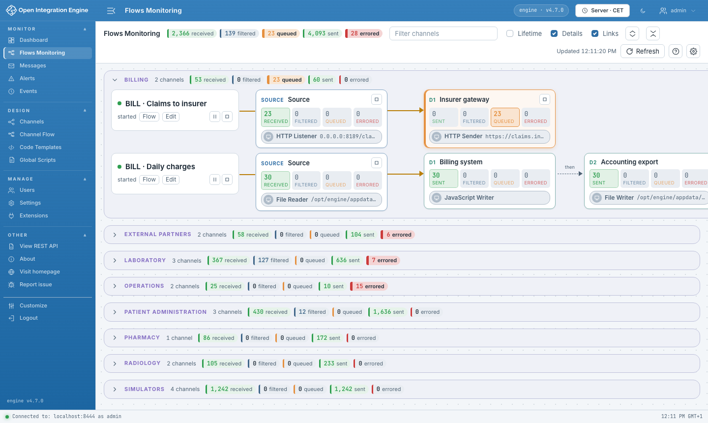
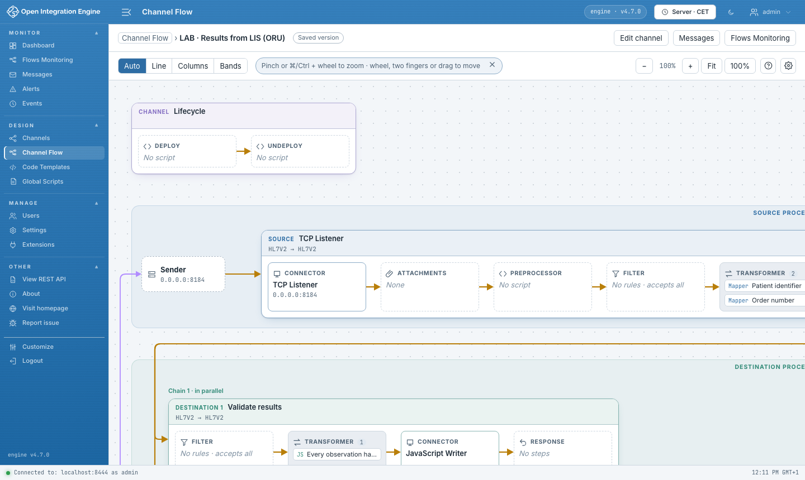

# OIE Flow UI

A plugin for the [Open Integration Engine](https://github.com/OpenIntegrationEngine/engine)
web administrator that shows how messages move through channels.

## Try the demo

You need Docker with Compose.

```sh
git clone https://github.com/kazepoy/oie-flow-ui-plugin.git
cd oie-flow-ui-plugin/demo
docker compose up -d --build
```

The first start compiles OIE 4.7.0 from source and takes several minutes. Then
open <https://localhost:8444/oie-webadmin/> (self-signed certificate) and sign in:

| Account | Password | What it shows |
|---|---|---|
| `admin` | `demo-oie-password` | Everything |
| `integrator` | `demo-oie-password` | Design and Monitor: Channel Flow, channel editor, `+` to add a step |
| `ops` | `demo-oie-password` | Monitoring of every channel, messages, Channel Flow, start, pause and stop |
| `lab-viewer` | `demo-oie-password` | The *Laboratory* group only, without channel configurations |
| `auditor` | `demo-oie-password` | Counters only, without messages |

The demo is the integration platform of a hospital: 19 channels in 8 groups,
messages already processed, a queue, errors, a paused and a stopped channel.

```sh
docker compose --profile traffic up -d   # keep messages coming
./reset.sh                               # back to the initial state
```

More in the [demo guide](demo/README.md) (in French).

## Screens

**Flows Monitoring** (Monitor menu): deployed channels by group, one row per
channel, with message counters for each connector. A counter opens Messages on
that connector. *Links* shows which channels send to which. Channels and
connectors start, pause and stop from their cards.



**Channel Flow** (Design menu, *Show flow* in the channel list, *Flow* tab of the
channel editor): a zoomable diagram of a channel, from the sender to the response,
in three views. Every component opens its editor; in the editor's tab, `+` adds a
step.



- Smooth with a trackpad (two fingers to move, pinch to zoom), a mouse (wheel to
  move, Ctrl/⌘ + wheel to zoom) and the keyboard; each view keeps its zoom and
  position for the session.
- Works with the Role Based Access Control plugin: only what the user's role allows.
- Settings follow the user from one browser to another (gear button, or
  Manage › Settings › Flow UI).
- English interface, ready for translation.

## Goal

The ultimate goal is for these features to become **native in OIE Web Admin**.

The plugin is a place to build and validate them first. It therefore uses only
the public plugin API of Web Admin, without workarounds, so that the code can be
moved into Web Admin later. When that API falls short, the plugin offers a
simpler behaviour and the gap is recorded as a request for Web Admin
([platform limits](doc/platform-limits.md)).

One exception: Web Admin cannot open a tab, a script, a destination or a step of
the channel editor, so Channel Flow selects them through the controls the editor
renders. This code is kept in one file (`src/host/editor-dom.js`) and, if a
control is missing, a message says where to click.

## Origin

I first wrote Flow and Flows quickly, by vibe coding, inside my
[FHIR Profile Mapper](https://github.com/kazepoy/oie-fhir-profile-mapper-plugin)
plugin, although they have nothing to do with FHIR. The reason was the
ergonomics inherited from Mirth Connect, which I find neither intuitive nor
suited to daily use: channels are hard to read at a glance, and the design is
still in the spirit of Windows XP and Java Swing.

That first version worked but was not built to last. This project extracts the
two screens and rebuilds them properly as a standalone plugin.

## Install

Requirements: Open Integration Engine 4.7.0,
[Web Support](https://github.com/gibson9583/oie-web-support-plugin) 1.3.0
(Web Admin 1.3.0); optional
[Role Based Access Control](https://github.com/diridium-com/role-based-access-control) 1.3.0.

Build the extension (Node 22 or later), install `dist/flow-ui-<version>.zip` in
*Settings > Extensions* of OIE and restart it. The plugin has no Java code.

```sh
npm ci
npm run build       # dist/flow-ui-<version>.zip
npm test            # unit tests
npm run check       # type check of the JavaScript
npm run test:e2e    # end-to-end tests against the running demo
```

> **Status: 0.8.3.** See the [project plan](doc/plan.md)
> and the [TODO list](doc/TODO.md).

## Documentation

Detailed documentation is in French:

- [User guide](doc/user-guide.md)
- [Architecture](doc/architecture.md)
- [Translations](doc/i18n.md)
- [Project plan](doc/plan.md) and [TODO](doc/TODO.md)
- [Platform limits](doc/platform-limits.md): gaps in OIE, Web Admin and RBAC
  that affect this plugin

## License

[Mozilla Public License 2.0](https://mozilla.org/MPL/2.0/).
