# Guide d'utilisation

## Flows Monitoring (menu Monitor)

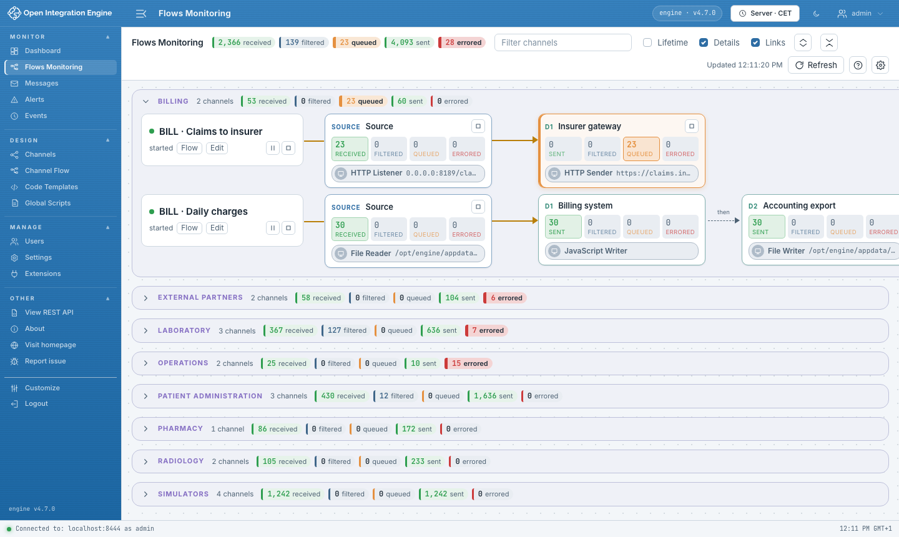

Les canaux déployés, par groupe. Chaque ligne se lit de gauche à droite : le canal
et son état, sa source, puis ses chaînes de destinations. Les chaînes reçoivent le
message en parallèle ; dans une chaîne, *then* marque une destination qui attend la
précédente.

- **Compteurs.** Received (source) ou Sent (destination), puis Filtered, Queued,
  Errored. Un compteur non nul prend la couleur de son statut : vert, gris-bleu,
  orange, rouge. Une carte en erreur ou avec une file d'attente se voit de loin :
  bordure, barre à gauche et fond rouges ou orange. Un connecteur arrêté est en
  pointillés.
- **Clics.** Une carte ou un compteur ouvre Messages sur ce connecteur ; le nom du
  canal ouvre Messages pour tout le canal ; *Flow* ouvre Channel Flow ; *Edit*
  ouvre l'éditeur. Messages s'ouvre filtré sur le connecteur : la ligne *Current
  Search* l'indique, même si le champ *Connector* affiche encore *Any* (WA-15). Il ne
  peut pas encore s'ouvrir sur un statut : le choisir dans son filtre *Status*.
- **Groupes.** Le premier est ouvert, les autres fermés (réglable) ; un groupe fermé
  garde ses totaux. Le filtre par nom ouvre les groupes qui contiennent un résultat.
  *Lifetime* affiche les compteurs depuis la création des canaux.
- **Liens entre canaux.** Avec l'option *Links* (cochée par défaut), une destination
  *Channel Writer* indique dans sa carte le canal qu'elle appelle (*Sends to*), et la
  carte du canal appelé ceux qui l'appellent (*Called by*). Un clic ouvre le groupe du
  canal lié, y fait défiler la page et le met en évidence, même s'il est dans un
  autre groupe.
- **Démarrer, mettre en pause, arrêter.** La carte du canal propose les commandes
  permises par son état : pause et arrêt s'il tourne, reprise et arrêt s'il est en
  pause, démarrage s'il est arrêté. Chaque connecteur d'un canal démarré ou en pause
  s'arrête ou redémarre seul ; arrêter la source met le canal en pause. OIE n'arrête
  une destination seule que si sa file d'attente est activée : sinon son bouton
  d'arrêt est grisé (OIE-12). Un arrêt demande confirmation ; si l'état ne change
  pas, un message le signale. Il faut le droit
  `startStopChannels` ; sans lui, les boutons n'apparaissent pas.
- **Rafraîchissement.** Les compteurs se relisent toutes les 5 secondes (réglable),
  onglet visible. *Refresh* relit aussi les groupes, les chaînes et les liens.

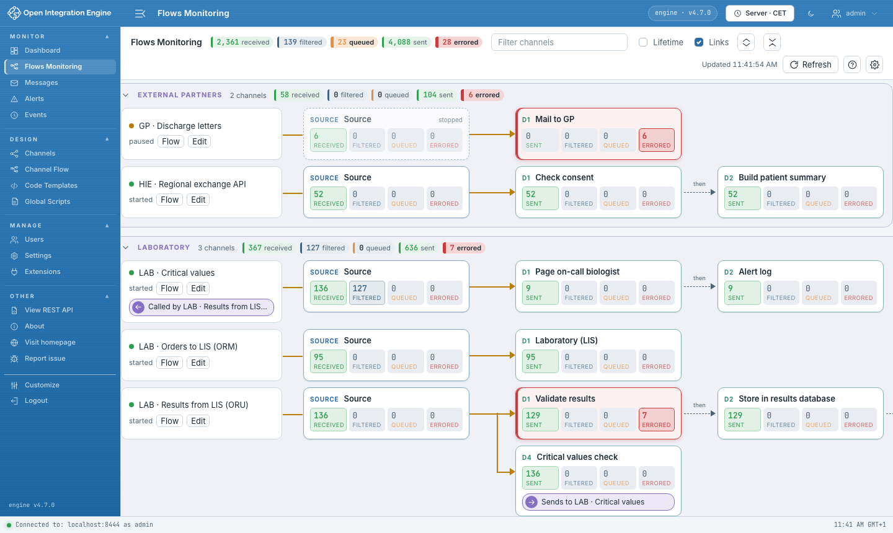

Le bouton `?` rappelle comment lire une ligne et ce que fait un clic :

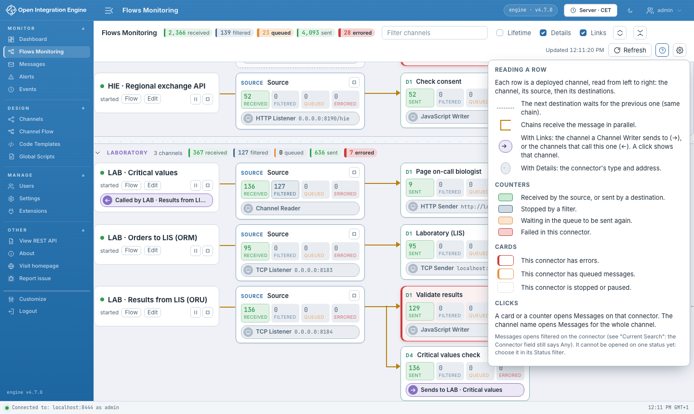

## Channel Flow (menu Design)

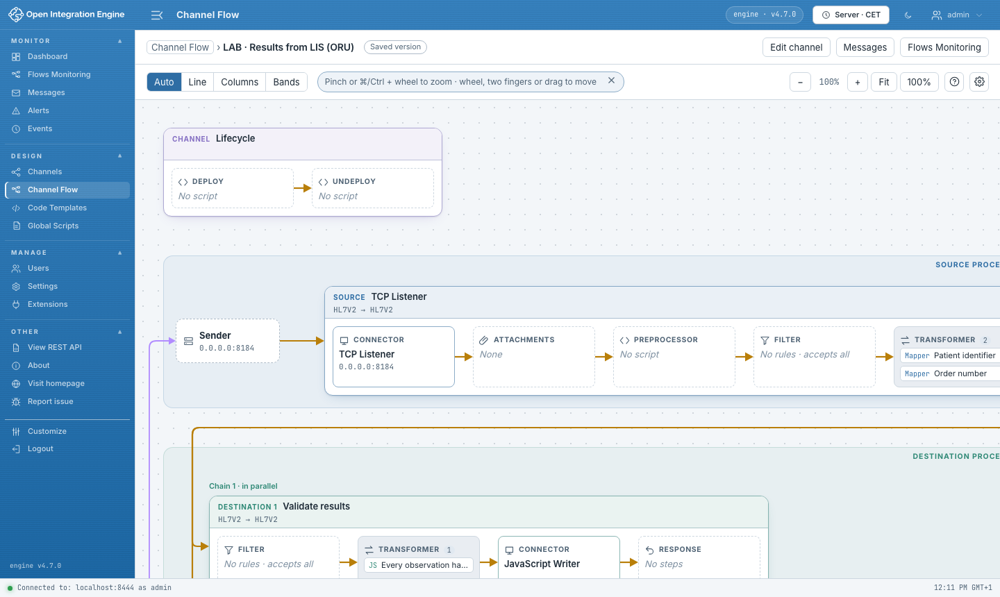

Le parcours d'un message dans un canal : l'émetteur, la source, les chaînes de
destinations, le postprocessing et la réponse. Trois façons d'y arriver :

- le menu **Design › Channel Flow**, puis le canal ;
- **Show flow** dans le menu contextuel de la liste des canaux ;
- **Flow** sur une ligne de Flows Monitoring.

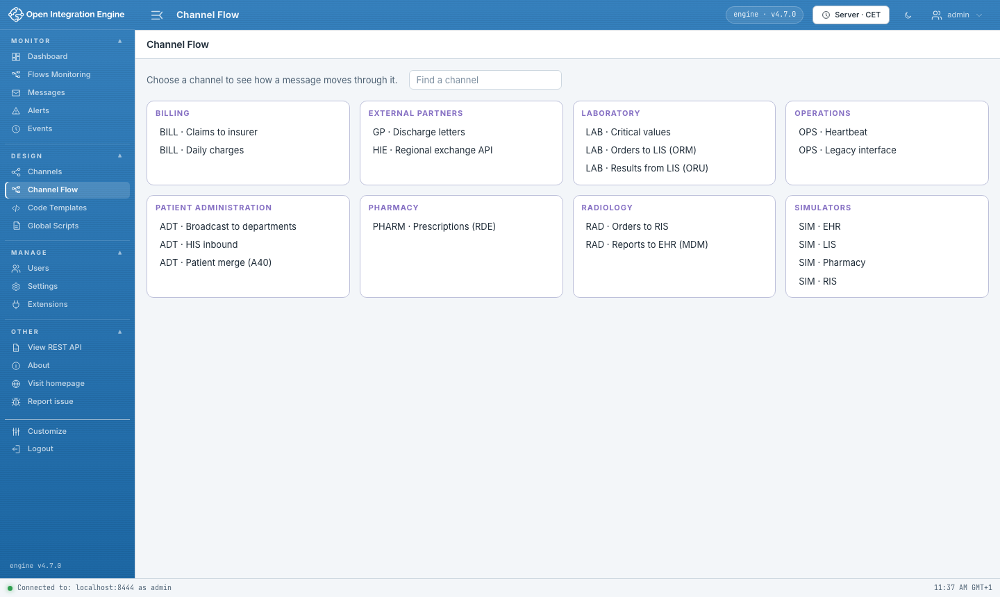

Ces entrées montrent la **version enregistrée** du canal. L'onglet **Flow** de
l'éditeur de canal montre le **brouillon** en cours, modifications non enregistrées
comprises ; c'est là que `+` ajoute une étape à un filtre ou un transformer.

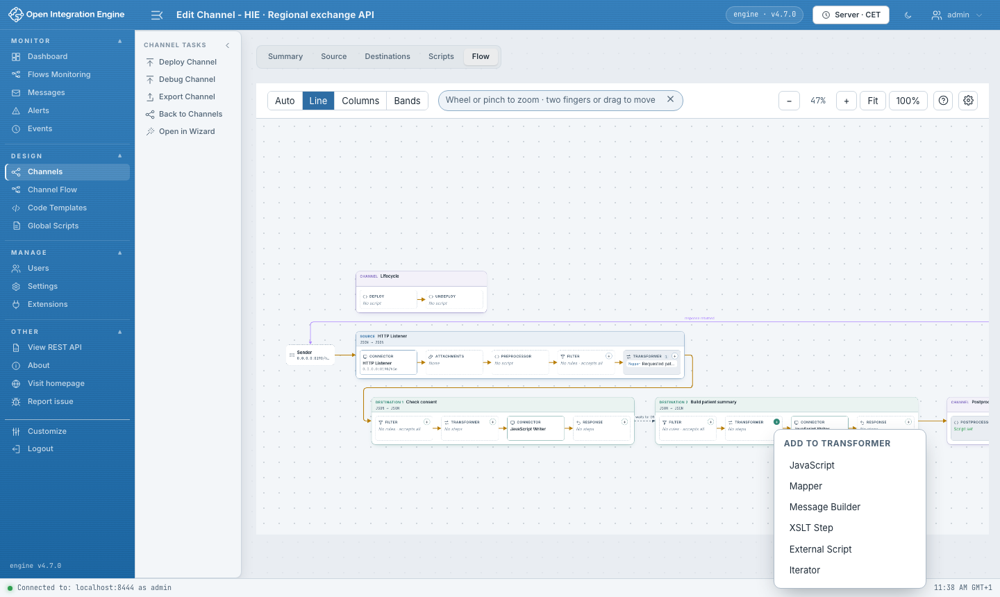

### Vues

| Vue | Se lit | Pour |
|---|---|---|
| Line | de gauche à droite | peu de destinations |
| Columns | de haut en bas, une colonne par chaîne | plusieurs chaînes courtes |
| Bands | trois bandes, un bloc par ligne | beaucoup de destinations, chaînes longues |

*Auto* choisit d'après la forme du canal (Bands dès 5 destinations ou une chaîne
de 3, Columns s'il y a plusieurs chaînes, sinon Line).

| Line | Columns | Bands |
|---|---|---|
| 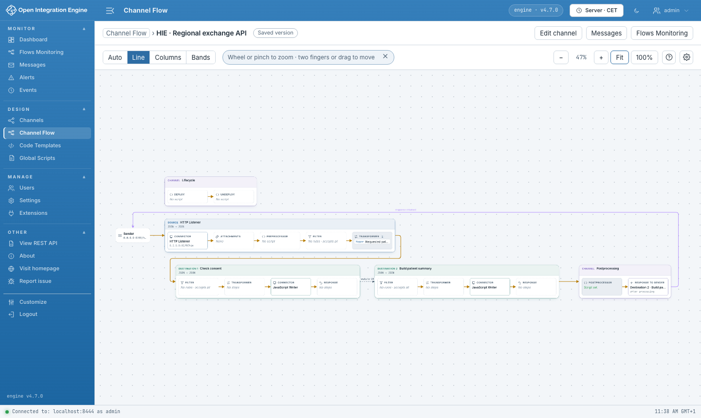 | 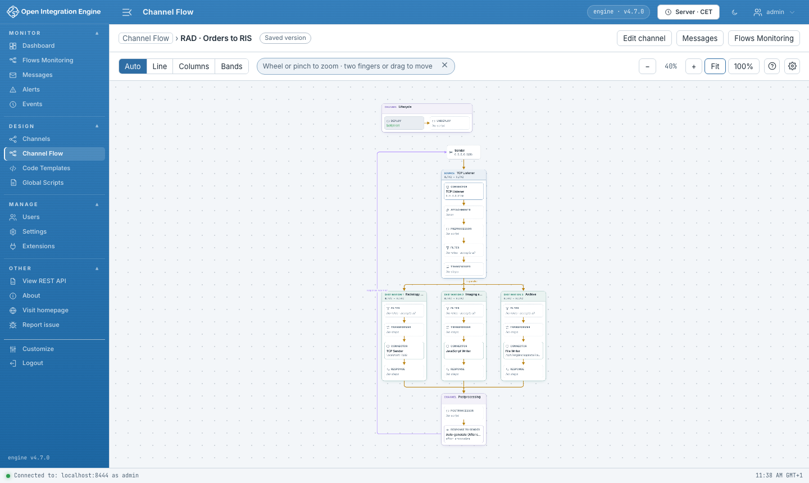 | 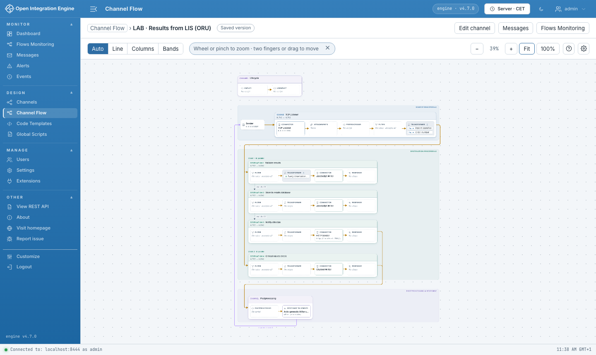 |

### Flèches

| Flèche | Sens |
|---|---|
| Ambre | Trajet du message |
| Pointillés gris, *waits for Dn* | La destination attend la précédente |
| Violette, *response returned* | Réponse renvoyée à l'émetteur |
| Pointillés clairs, *disabled* | Destination désactivée : elle ne reçoit rien |

### Se déplacer

| Geste | Effet |
|---|---|
| Pavé tactile, deux doigts | Déplacer |
| Pavé tactile, pincement | Zoomer |
| Molette de souris | Déplacer ; Maj + molette : à l'horizontale ; ⌘/Ctrl + molette : zoomer |
| Glisser le fond, ou Espace + glisser | Déplacer |
| Flèches du clavier | Déplacer (Maj : plus vite) |
| `+` `-` | Zoomer |
| `0` | Tout afficher (*Fit*) |
| `1` | Taille réelle, depuis le début du flux (*100%*) |

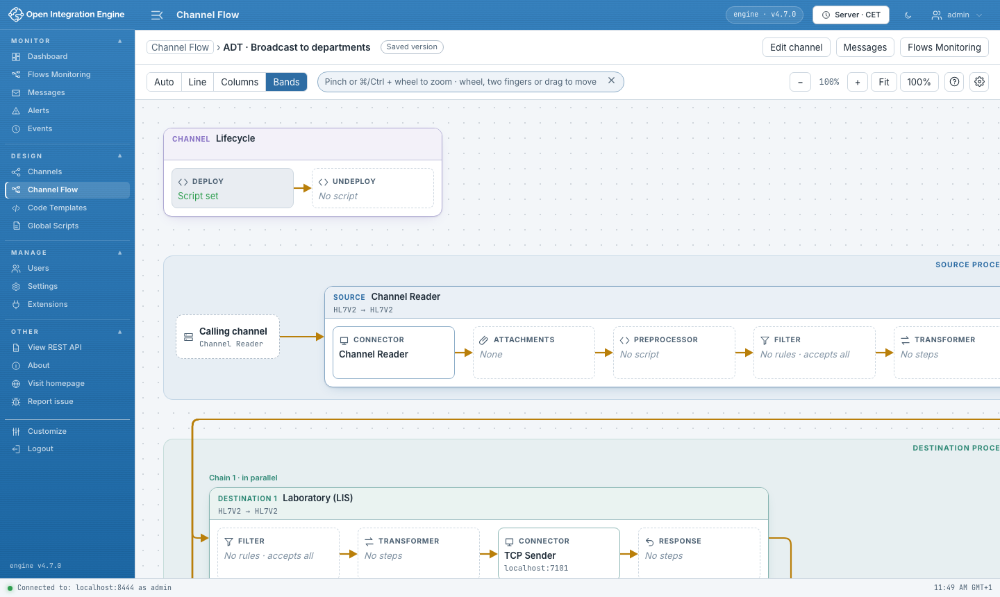

Le schéma s'ouvre à 100 %, au début du flux. En quittant la page et en y revenant,
on retrouve la vue, le zoom et la position, le temps de la session du navigateur.
Le bouton `?` rappelle les flèches et les gestes :

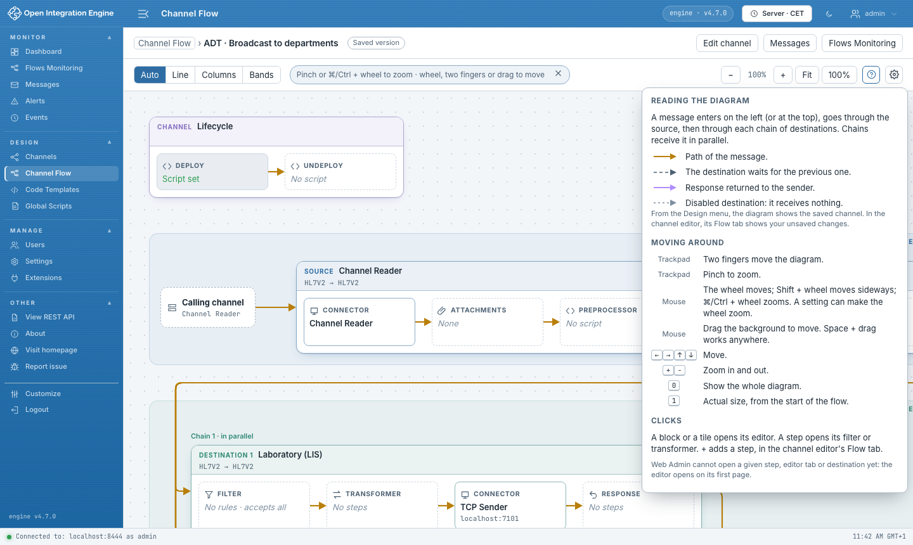

### Clics

Un bloc ou une tuile ouvre son éditeur ; une étape ouvre son filtre ou son
transformer. Une tuile montre ses 5 premières étapes (réglable) ; *+N more* les
liste toutes. Web Admin ne permet pas encore
d'ouvrir une étape, un onglet ou une destination précis : depuis l'onglet Flow, un
message indique l'onglet à ouvrir.

## Réglages

Le bouton ⚙ de chaque écran montre les réglages de cet écran ; **Manage › Settings ›
Flow UI** les montre tous. Les réglages appartiennent à l'utilisateur, le suivent
d'un navigateur à l'autre et s'appliquent aussitôt :

| Écran | Réglage |
|---|---|
| Flows Monitoring | Groupes ouverts par défaut (le premier, tous, aucun) ; rafraîchissement des compteurs |
| Channel Flow | Vue par défaut ; étapes affichées par tuile (3, 5, 8 ou toutes, puis « +N more ») |

Un lien permet de réafficher les indices masqués.

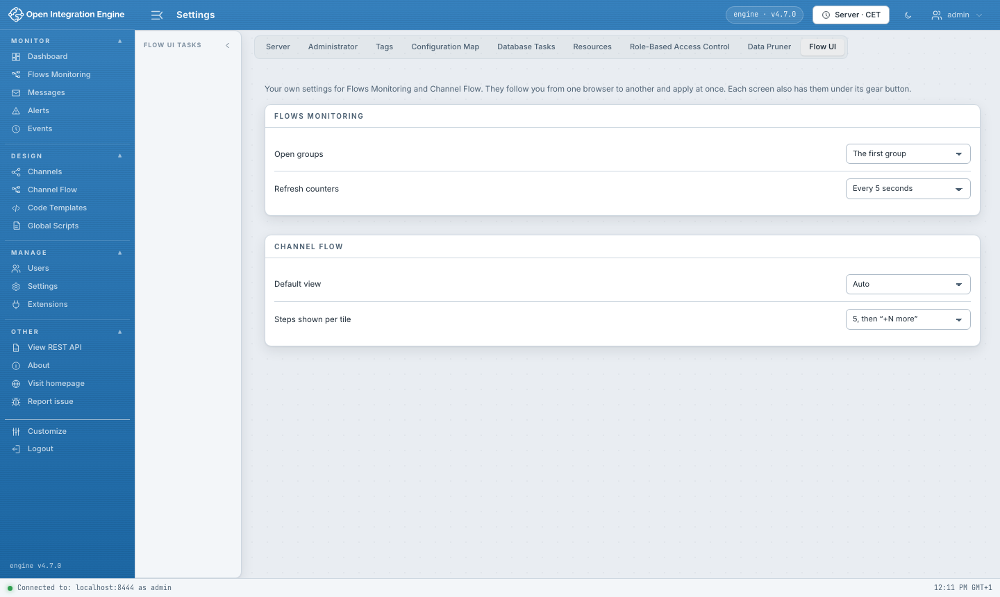

## Droits (Role Based Access Control)

Flow UI suit les droits de Web Admin :

| Élément | Droit |
|---|---|
| Flows Monitoring | `viewDashboard` |
| Groupes dans Flows Monitoring et le sélecteur | `viewChannelGroups` (sinon une seule liste, *Groups hidden*) |
| Chaînes de destinations et liens dans Flows Monitoring | `viewChannels` (sinon les destinations dans l'ordre, sans liens, *Chains hidden*) |
| Channel Flow | `viewChannels` |
| Compteurs et noms cliquables vers Messages | `viewMessages` |
| *Edit*, ouverture des éditeurs, `+` | `manageChannels` |
| Démarrer, pause, reprise, arrêt (canal et connecteurs) | `startStopChannels` |

Le serveur ne renvoie que les canaux autorisés : un rôle restreint à quelques
canaux ne voit qu'eux, et les totaux ne comptent qu'eux.

## Démonstration en cinq minutes

Avec la [démo](../demo/README.md), compte `admin` :

1. **Monitor › Flows Monitoring.** Ouvrir le groupe *Laboratory* : *LAB · Results
   from LIS* a une destination en erreur (bordure rouge).
2. Cliquer son compteur **Errored** : Messages s'ouvre sur cette destination ;
   choisir *Errored* dans *Status* pour lire l'erreur (résultat sans valeur).
3. Revenir et cliquer **Flow** sur la ligne : Channel Flow montre la chaîne
   *Validate → Store → Notify* en vue Bands, et la quatrième destination en
   parallèle.
4. Ouvrir le **Transformer** de *Validate results* : l'étape qui rejette les
   résultats incomplets.
5. Se reconnecter en `ops` : sur la ligne *OPS · Heartbeat*, mettre le canal en
   pause, le reprendre, l'arrêter (confirmation) puis le redémarrer.
6. Se reconnecter en `lab-viewer` : seul le groupe *Laboratory* reste, sans
   Channel Flow, *Edit* ni commandes, et les chaînes sont masquées (*Chains hidden*)
   faute de pouvoir lire les canaux. En `auditor` : les compteurs ne s'ouvrent plus.
